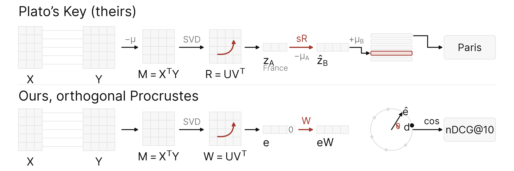
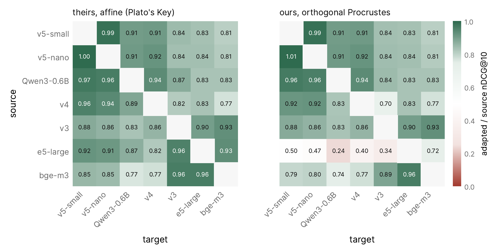

# Embedding Compatibility Adapters

[[Report](report.pdf)]

Your embedding provider deprecated their model, you have millions of documents embedded with the old one, and re-embedding costs days of compute. A map fitted on a few thousand paired texts repairs the mismatch: one SVD, one matrix multiply, no training loop, no GPU.

Two numbers decide whether that map will work, and both come from the paired texts before you fit anything.

| diagnostic | what it measures | what it predicts | correlation over 42 pairs |
|---|---|---|---|
| frame correlation `rho` | mean cosine between the two models' embeddings of the same text | whether you need a map at all | 0.95 with the identity baseline, -0.91 with what a map adds |
| anisotropy `kappa` | `‖mean‖ / RMS(x − mean)` of one model | whether a rotation is enough | 0.87 with the gain of the affine form over the rotation |
| direction | expanding (`d_s < d_t`) or compressing | which failure to expect | a rotation loses 0.099 nDCG when it expands |

`rho` is the one nobody computes. CKA, the usual geometric gate, is invariant to rotation, so it cannot see the thing a map repairs: v5-nano and v5-small have CKA 0.958 and `rho = -0.001`, and doing nothing between them retrieves 0.002 nDCG@10. jina-v3 and bge-m3 have CKA 0.729 and `rho = 0.325`, and doing nothing already reaches 0.542.

## Two maps, one skeleton



**Theirs, top, Plato's Key (Cheng, Liu, Yau, HazyResearch, 2026).** The unit is one hidden state of a frozen LLM at a chosen layer and token, the "key" that later layers use to retrieve a fact from the weights. The map is affine: subtract the donor's mean key, rotate by the orthogonal solution `R = UVᵀ`, multiply by one global scale `s = ‖Ỹ_B‖_F / ‖Ỹ_A‖_F`, add the recipient's mean back. The output is swapped in for the recipient's own key at layer `ℓ_B` and the recipient's remaining layers answer. Their purpose is to make one model use another's representation, and their calibration is a few thousand facts both models recall.

**Ours, bottom, orthogonal Procrustes.** The unit is the pooled output vector of a text embedding model, one per query or document. The map is a pure rotation `W = UVᵀ` fitted on paired texts, with no centring and no scale, because cosine similarity is scale invariant and the target's index is stored uncentred. A query is zero-padded to the wider space, multiplied once, truncated back, renormalized, and compared against the target model's own corpus embeddings. The output is a ranking, scored as nDCG@10. Our purpose is to keep a corpus usable across a model switch.

The two rows share the estimator: a cross-covariance of paired representations, one thin SVD, one orthogonal solution. They differ in the object (an intermediate state consumed by the next layer, or a final vector consumed by a similarity), in the affine terms, and in what the output has to satisfy.

**What we took from them.** Three things. The affine form is now a second candidate in `adapter.py`, and it wins: it beats the rotation on 18 of 42 pairs with 14 significant wins and no significant losses, because an uncentred rotation is dominated by the mean direction when a model is anisotropic. Their evaluation protocol: select the operating point on validation queries by the downstream metric, fit on calibration, report on held-out, with controls at the same operating point. Their analyses: chaining, low-rank compression, and the recovery of retrievals only the donor model can produce.

## What a bridge actually buys

42 directed pairs, seven models from five families, 13 NanoBEIR tasks, 5,000 calibration texts, 429 held-out queries. Three numbers per pair, the old model on its own index, the adapted query on the new index, and the new model natively. The two rows marked ours and Plato's Key are the two maps of the figure above; the rest are alternatives and controls.

| method | nDCG@10 | of source | of target | significant wins | significant losses |
|---|---|---|---|---|---|
| orthogonal Procrustes (ours) | 0.5244 | 0.805 | 0.810 | - | - |
| affine, centre + scale + rotation (Plato's Key) | 0.5718 | 0.882 | 0.882 | 14 | 0 |
| ridge CCA, rank selected on validation | 0.5708 | 0.881 | 0.881 | 12 | 7 |
| SGD linear, InfoNCE | 0.5360 | 0.827 | 0.827 | 7 | 26 |
| SGD 3-layer MLP, InfoNCE | 0.5232 | 0.807 | 0.807 | 7 | 28 |
| kernel ridge, RBF | 0.4764 | 0.735 | 0.732 | 7 | 26 |
| random semi-orthogonal map | 0.0027 | 0.004 | 0.004 | 0 | 42 |
| Procrustes on shuffled pairs | 0.0035 | 0.005 | 0.005 | 0 | 42 |



The two heatmaps are the two maps of the figure above, on one colour scale that runs 0 to 1, where 1 is the old model's own score. Left is theirs, right is ours. Two cells sit at 1.00 and 1.01 and are capped at the top of the scale. The two panels agree almost everywhere; the e5-large row is the one an uncentred rotation cannot bridge at all, 0.24 to 0.50, and the affine terms of Plato's Key put it back at 0.82 to 0.96.

The map is not a migration. A rotation recovers 0.81 of the old index's nDCG@10 and the affine form 0.88, and neither beats keeping the old index except between two consecutive checkpoints of one family. If you migrate, the documents you already serve get worse by 4 to 51 points of nDCG@10 and the new model has to earn that back on documents it handles better.

Where the map does earn its place is the documents only the old model retrieves: a rotated query recovers 0.28 of them on average, without touching any weights.

## Quick start

```python
import numpy as np
from adapter import diagnose, affine_align, procrustes_align

# X_source, Y_target: embeddings of the same few thousand texts, one row each
print(diagnose(X_source, Y_target))
# {'rho': 0.31, 'kappa_source': 0.27, 'kappa_target': 0.74, ...}

f = affine_align(X_source, Y_target)     # centre, rotate, rescale, re-centre
adapted_queries = f(query_embeddings)    # score against the target's own index

W = procrustes_align(X_source, Y_target) # orthogonal only, when kappa is low
```

```bash
uv run adapter.py     # synthetic demo: rotation-only vs rotation-plus-mean
```

Fit on paired texts, never on the evaluation set. The calibration should cover both roles a text plays: half embedded as queries, half as passages.

## Reproducing the study

```bash
pip install -r requirements.txt
python embed_local.py qwen3_06b     # local models on a GPU; the jina models come from the API
python run_all.py --models v3,v4,v5nano,v5small,qwen3_06b,bgem3,e5large --out results.json
python paper/analysis.py --results results.json --out paper/summary.md --tables paper/tabs
python paper/figures.py --results results.json --dir paper/figs
```

`align/` holds the pipeline: `data.py` (tasks, qrels, cached embeddings), `adapters.py` (every map, closed form except the two SGD controls), `evaluate.py`, `protocol.py` (fit on calibration, select on validation, report on test), `analyses.py` (predictors, chaining, the generalized-Procrustes hub, low rank).

`paper/` holds the report source, `results.json` with every number, and the scripts that turn it into the tables and figures.

## Limits

NanoBEIR is 50 queries per task, so per-pair differences under about 0.02 nDCG are noise. The calibration is AG News for all 42 pairs, the query split uses one seed, and the operating points are selected on 17 validation queries per task. The query is adapted and the target index is left native; converting the corpus into the new space instead is equivalent only for an orthogonal map.

## License

Apache 2.0
